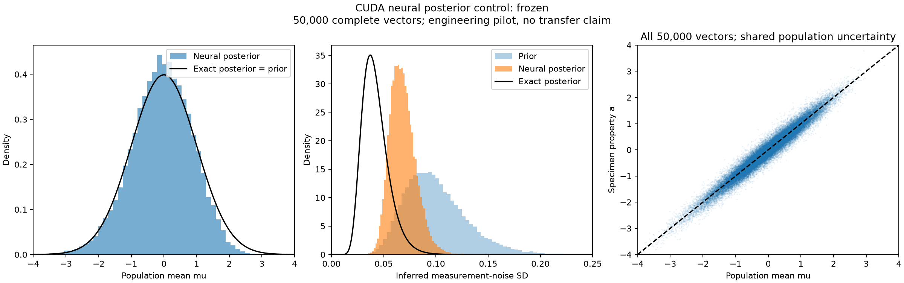
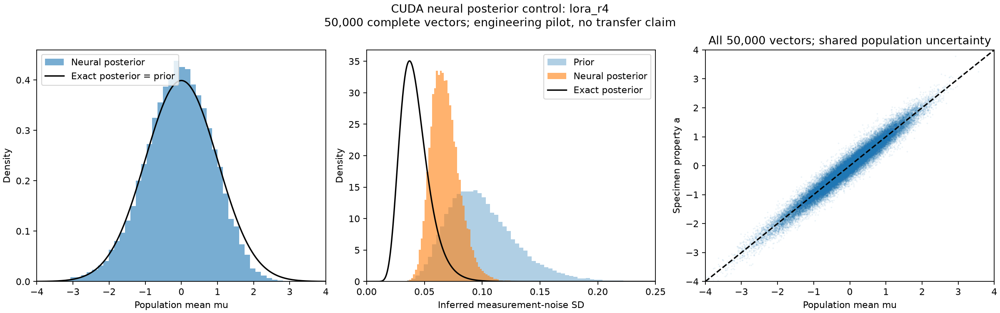

# First CUDA engineering pilot

Built with PriorLabs-TabPFN.

The core CUDA checks passed, with explicit capacity and scientific limits. This is a partial I07 qualification; production campaigns remain gated.

All three methods (LoRA-r4, LoRA-r16 and full fine-tuning) produced bitwise-equal weights, optimizer state, future random draws and deployment predictions after interrupted/restarted execution. Each trajectory contains two updates at effective batch 16; reference and restart replay cost four actual optimizer steps per method. The 200-update pilot learning-rate trials have not started.

CPU/CUDA parity now has maximum CDF discrepancy 2.97e-07, without changing the declared tolerance. The initial failure exposed device-dependent random positional vectors; CUDA now uses the CPU-seeded vector while retaining its projection and gradients on GPU. CPU behavior is unchanged.

| Method | Two continuous update seconds | 50,000-vector sampling seconds |
|---|---:|---:|
| Frozen | — | 112.70 |
| LoRA-r4, unmerged | 590.66 | 281.18 |
| LoRA-r16 | 586.72 | unrun |
| Full fine-tuning | 259.31 | unrun |

These are single timing observations on a small engineering fixture. Training uses four unknowns and 16-world contexts; inference uses four unknowns, ten observations, 256 worlds and microbatches 1024. Sampling includes context preparation and complete decoding, excluding model load, trace collection and plot/artifact output. No speedup against the historical 21-parameter benchmark is claimed. Unmerged LoRA overhead is visible.

The exact analytical noise posterior is still missed: noise marginal CDF errors are 0.7351 (frozen) and 0.7325 (two-update rank4), with mean biases 2.06 and 2.04 reference SD. These exceed the agreed 0.10 CDF and 0.20 reference-SD diagnostics. These two updates check engineering, not learning quality or transfer.

Full-model frozen inference memory probes at 1024 worlds completed: 35 unknowns / 70 observations used 8.29 GB peak allocated memory; 75 unknowns / 200 observations used 20.42 GB. The latter case at 4,096 worlds ran out of memory. Its 31.76 GB recorded peak precedes the failed allocation and is not an estimate of the memory needed to fit. These Q1 last-conditional probes do not qualify complete large-problem inference or training.

The three scheduler allocations include a retained cancellation and a FAILED allocation caused by the stock CPU preprocessing size guard; successful core checks do not rewrite those scheduler outcomes. The separate probe job allowed large CPU preprocessing while keeping neural execution on CUDA. Total actual cost, including failures and idle allocated workers: **2.366667 GPU-hours**; outstanding reservations: 0.0. The historical 200-hour ledger is untouched.

See qualification.json, raw-artifacts.json, per-method receipts and CPU/CUDA profiler tables. Large traces, arrays and checkpoint states remain outside Git; model publication is deferred. All full posterior requests produced exactly 50,000 complete vectors, without clipping or replacement.
