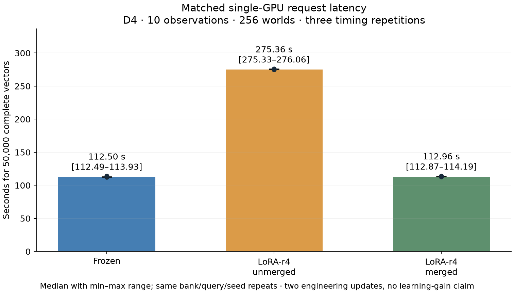
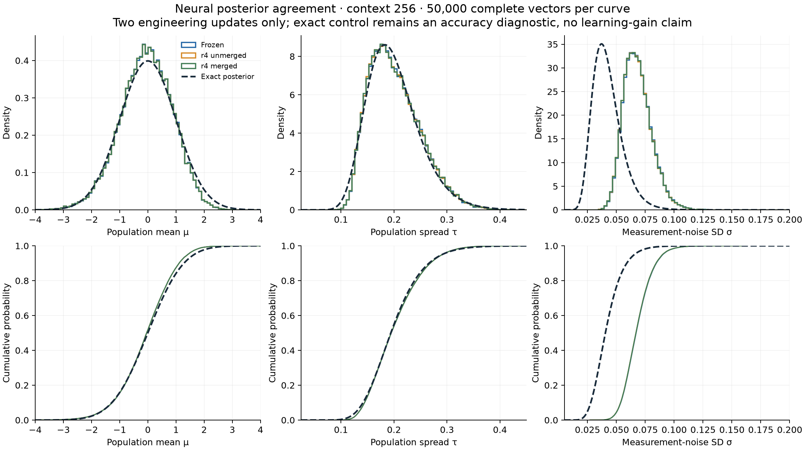
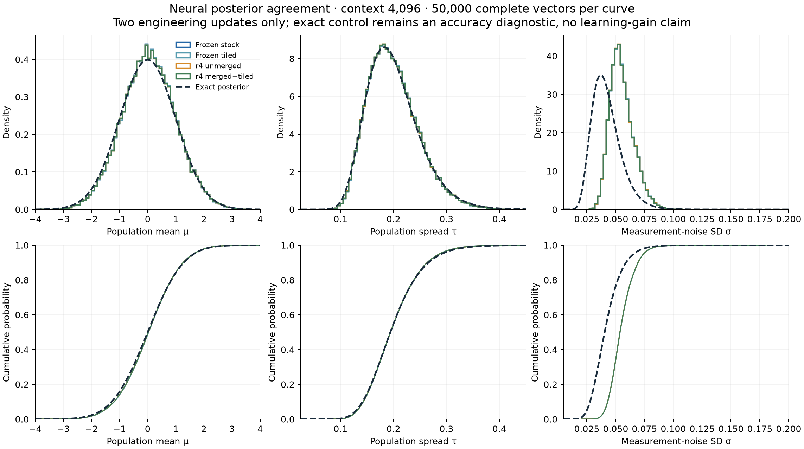
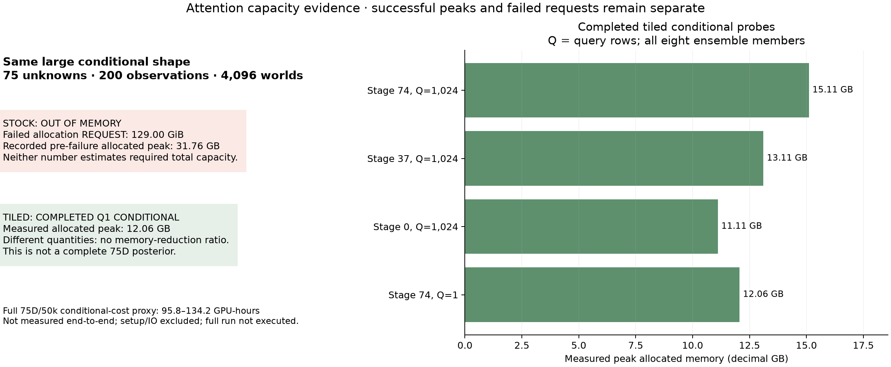

# Inference memory and PEFT deployment qualification

Built with PriorLabs-TabPFN.

The exact 75-unknown, 200-observation, 4,096-world conditional that previously failed now completes on one A100 40 GB, with 12.06 GB peak allocated memory. Merging the retained rank4 LoRA adapter cuts median 50,000-vector latency from 275.36 to 112.96 seconds on the four-unknown/256-world control (2.44x). Execution preservation passes on these fixtures; scientific posterior accuracy remains unqualified.

## What changed and why

The stock math attention path attempted one 129 GiB score allocation. The adapter tiles batches and query rows while retaining all keys for each softmax, limiting each score tensor to 512 MiB. This is a score-block limit, not a bound on total GPU memory. FP32 neural execution, FP64 density/decoding, all eight ensemble members, the complete context, and math attention remain fixed. Small calls and gradient-enabled training retain the stock path.

The unmerged PEFT path repeatedly reconstructs packed attention weight updates and also executes ordinary low-rank linear branches. The profiled conditional contains 4,640 matrix-multiplication calls versus 200 for frozen and merged deployments; CUDA kernel launches fall from 28,995 to 13,179. The new deployment loader calls genuine Hugging Face PEFT merge_and_unload, then resolves the TabPFN packed-weight compatibility layers. It starts from a fresh authenticated checkpoint, preserves the original files, and fingerprints both origin and actual merged weights. Training behavior is unchanged.

## Complete posterior requests

| Worlds | Variant | Repeats | Seconds, median [min, max] | Peak allocated GB | Noise marginal CDF error |
|---:|---|---:|---|---:|---:|
| 256 | frozen | 3 | 112.50 [112.49, 113.93] | 1.09 | 0.7351 |
| 256 | merged | 3 | 112.96 [112.87, 114.19] | 1.09 | 0.7324 |
| 256 | unmerged | 3 | 275.36 [275.33, 276.06] | 1.10 | 0.7325 |
| 4096 | frozen_stock | 1 | 1140.57 [1140.57, 1140.57] | 16.91 | 0.4891 |
| 4096 | frozen_tiled | 1 | 1207.76 [1207.76, 1207.76] | 1.54 | 0.4891 |
| 4096 | r4_merged_tiled | 1 | 1205.47 [1205.47, 1205.47] | 1.54 | 0.4880 |
| 4096 | r4_unmerged | 1 | 1194.50 [1194.50, 1194.50] | 16.92 | 0.4881 |
| 256 | frozen_tiled_audit | 1 | 112.86 [112.86, 112.86] | 1.09 | 0.7351 |

C256 values are three repeats of the same bank/query/seed; they measure timing variability, not independent scientific cases. C4096 values are single observations per control, with no repeated speedup or scaling claim. Every request retains exactly 50,000 finite complete vectors; failures are never repaired by clipping, replacement or silent rejection. Model loading, profiler capture and artifact writing are excluded from sampler timings. Context preparation is included; timings.csv retains its separate measurement. The two context sizes use different banks, not a nested budget-comparison experiment. Setup and merge costs are retained in each deployment.json; cache/warm-up conditions differ between lanes, so they are not a controlled cold-start comparison. The measured merge operation itself takes about 0.07 seconds.

At C4096, frozen tiling lowers the directly comparable complete-request allocated peak from 16.91 GB to 1.54 GB while increasing the single observed runtime from 1,140.57 to 1,207.76 seconds. This demonstrates a memory/runtime tradeoff, not a faster kernel. The r4 unmerged/stock and merged/tiled controls take 1,194.50 and 1,205.47 seconds respectively; because attention policy also changes, these are not an isolated measurement of merging at C4096.

The distinct 512 MiB attention implementation also completed an extra 50,000-vector frozen C256 control; its stock/tiled samples are bitwise equal. All matched comparisons cover four coordinates plus 32 predefined projections and retain the same source, bank, query, seed and checkpoint identities. Across the retained comparisons, the largest empirical CDF difference is 0.00128, below the unchanged 0.01 investigation threshold. Conditional merge checks cover all eight raw predictions, the full shared border grid and seven central/tail quantiles, with maximum CDF difference 3.13e-07.

The adapter has only the two optimizer updates from the first engineering pilot; this task performs zero training updates. The noise posterior remains inaccurate. Preservation of that output demonstrates an execution change, not posterior-quality improvement, learning, transfer or simulation savings. The exact diagnostic control has a zero physical response: its observations inform measurement noise while the physical hierarchy retains its prior. It is deliberately separate from the sealed scientific study.

## Capacity and remaining runtime limit

The exact failed Q1 last-stage probe takes 103.66 seconds and peaks at 12.06 GB. Three Q1024 probes at stages 0/37/74 remain finite and peak up to 15.11 GB. Fitting C1024 stock-versus-tiled raw predictions, CDFs and quantiles agree bitwise. The old failed allocation request and the successful measured peak are different quantities; no memory-reduction ratio is reported.

Tiling solves capacity, not repeated computation. A proxy from the measured large conditional costs predicts roughly 95.8–134.2 single-GPU hours for 49 posterior microbatches times 75 parameter stages. This is not a measured end-to-end latency or a guaranteed bound; initial preparation and IO are excluded. No complete 75-dimensional posterior was launched. Context computation across batches and stages remains a major large-problem bottleneck.

The four allocated GPUs run independent complete-model workers for parallel checks; memory is not pooled. This stage does not implement or measure tensor/context parallelism, distributed training or fixed-workload multi-GPU strong scaling.

## Cost and reproducibility

This follow-up uses 2.350000 allocated GPU-hours across completed jobs 5449261 and 5449270, including idle allocated workers. The separate study ledger totals 4.716667 GPU-hours including the first pilot and its failed/cancelled attempts; reservations are zero. The original 200-hour ledger is unchanged. This preparation adds 4,097 inexpensive analytical forward executions, reuses the original two-update checkpoints and old probe banks, and makes zero Mirheo calls.

GPU producing source: `07f8909f0b862d68862ab46cf753b356879d4120`. Reporting source revision: `520d490ce99b2607b4e5157fb0814448eddb0a50`; its exact file hash is retained in summary.json. Inputs SHA256: `0b2e98555d425d2f857a16d9bd0c938e5f41108c9b2aa79b3e82167bbde1d922`. The source snapshot uses the separate complete hashed CUDA environment and pinned TabPFN-v2 checkpoint. [Summary](summary.json), [timings](timings.csv), [accounting](receipts/accounting-final.json), and [raw artifact index](raw-artifacts.json) bind the results to their source, models, arrays and jobs.

CPU evidence retains the 315-passed/17-expected-skip study suite from the qualified GPU source, seven cached-model attention checks, six deployment checks and 29 focused postprocessor integrity tests. Public CI additionally checks the final revision. Large sample arrays, traces and model states remain outside Git; the indexed SCRATCH location requires project access and is not presented as public hosting.

The public inference-only recipe is documented in [the pilot contract](../../docs/cuda-qualification-v1.md). Run the CPU report helper with --root pointing to the authenticated raw root and --output to a fresh directory. It fails closed on partial arrays, mismatched bank/source/checkpoint identities, wrong attention policy or an unfinished control. index.json authenticates the compact files in this evidence directory.

The bounded OOM/deployment task is complete. The 200-update learning-rate trials, main training, full scientific/reference qualification, target transfer, and model publication remain pending. No new learning-rate or training configuration was selected here.
