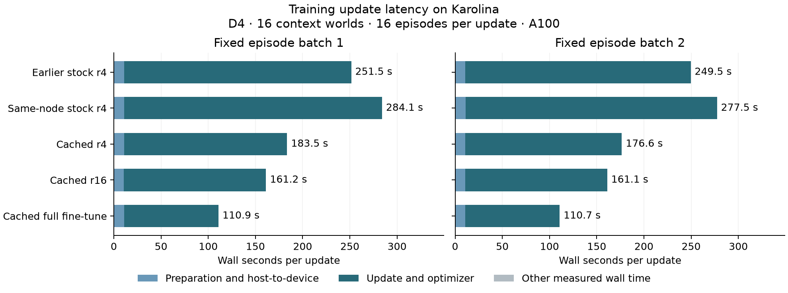
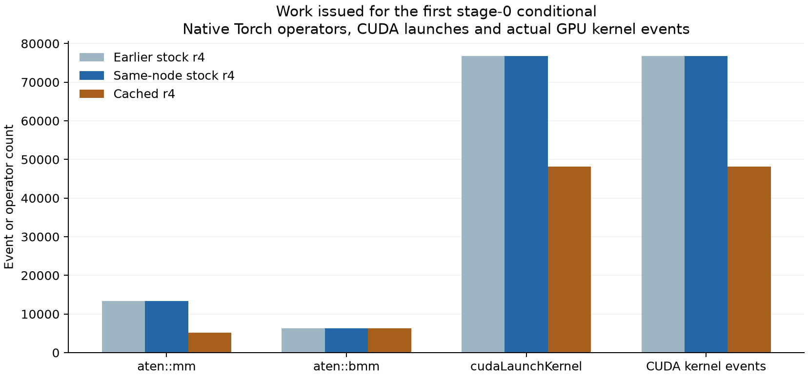
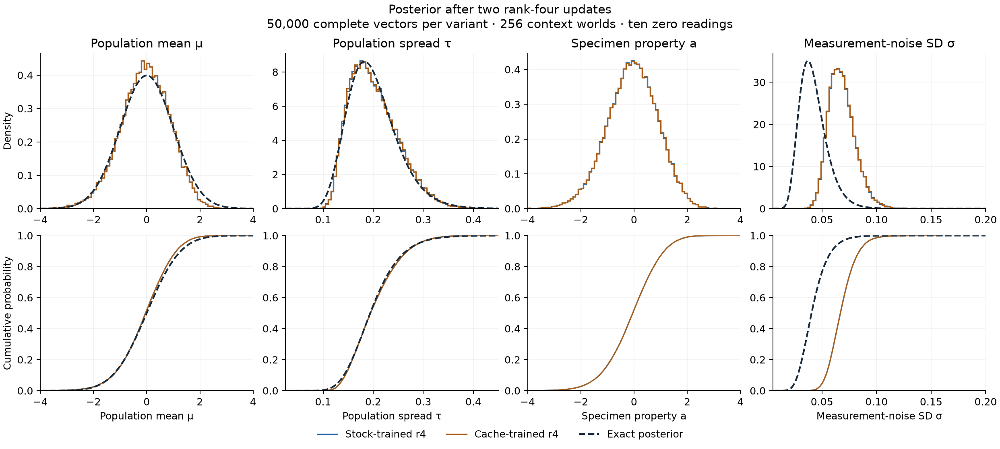
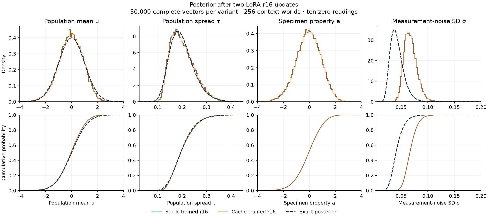

# FineTuneForge training execution on Karolina

Per-layer parametrization caching cut LoRA-r4 update wall time by **35–36%** across two matched batches on one Karolina A100 node. The rank-4 final model and optimizer passed the prescribed tensor checks. Rank 16 stayed within the relative posterior thresholds, and its final-weight comparison against historical stock failed. Measurement-noise bias persisted at both ranks. The separate Inductor candidate failed its gradient preflight. [Rank-4 report](report.json) · [Rank-16 report](rank16/report.json)

## Update latency and the first conditional

The same-allocation rank-4 lanes ran the same two fixed batches of 16 episodes, each with four parameters, 16 context worlds and one query case. Each timed update used all eight ensemble members, FP32 neural execution and the full-grid FP64 density `canonical_half_normal_full_support.v1`. Each layer invocation gets a fresh parametrization cache, including invocations during activation-checkpoint recomputation. Both lanes ran a separate first-conditional profile. The cached lane also ran conditional parity checks outside its timed updates. [Qualification receipts](qualification/) · [Fixed training inputs](inputs/original-training-manifest.json)

| Fixed batch | Stock wall | Cached wall | Wall speedup | Stock → cached update compute |
| --- | ---: | ---: | ---: | ---: |
| 1 | 284.10 s | 183.54 s | 1.55× | 273.19 → 172.48 s |
| 2 | 277.46 s | 176.57 s | 1.57× | 266.50 → 165.69 s |

Preparation and host-to-device transfer took about 11 s per update in both lanes. The earlier stock baseline took 251.52 and 249.55 s on a separate allocation. The cached rank-16 and full fine-tuning lanes are controls with different trainable parameters. The speedup ratios in the table use only the matched rank-4 lanes. [Earlier baseline receipt](baseline/baseline-result.json)

The first-conditional traces cover episode zero, stage zero (μ). The matched raw traces show **13,368 → 5,192** `aten::mm` calls, **6,360 → 6,360** `aten::bmm` calls, **76,732 → 48,164** `cudaLaunchKernel` calls and **76,748 → 48,180** actual CUDA kernel events. The summed durations of Chrome events with `cat = "kernel"` are 0.3152 → 0.1951 s. These per-event durations can overlap. GPU user annotations mark scope intervals and are excluded from the kernel totals. The CPU network and backward annotations span 2.102 → 1.307 s and 3.270 → 2.174 s. The complete traced conditional with preparation took 11.182 → 8.204 s. [Stock operators](qualification/stock_r4/operators.txt) · [Cached operators](qualification/cache_r4/operators.txt) · [Earlier trace category audit](baseline-profile-categories.json)

The archive index lists checksums and retrieval paths for the original Chrome traces, checkpoint payloads and posterior samples. Retrieval requires project access on Karolina. [Raw artifact index](raw-artifacts.json)

## Numerical checks and restart

At identical weights before training and after update one, LoRA-r4 and r16 produced bitwise-identical logits, full-grid density weights and loss on the representative conditional. For both ranks, the maximum gradient delta was 2.98e-8 initially and 2.24e-8 after one update. The elementwise tolerance was `atol=2e-7, rtol=2e-5`. Cached restart reproduced weights, optimizer, RNG progression, training state and deployment outputs for r4, r16 and full fine-tuning. [CPU numerics](receipts/independent-numerics-cpu.json) · [CUDA qualification](qualification/)

The separate two-update final-state checks used same-allocation stock for r4 and authenticated historical stock for r16 and full fine-tuning. Rank 4 passed both model and optimizer checks, with a maximum model delta of 4.02e-7 under the combined absolute and relative tolerance. Rank 16 failed 12 of 422 model tensor comparisons, with a maximum delta of 2.73e-6, and its optimizer passed. Full fine-tuning matched historical model and optimizer state bitwise. [Final-state comparisons](final-state-comparisons.json)

## Posterior comparison

Each stock and cached checkpoint produced **50,000 complete FP64 posterior vectors** on the same D4 zero-sensor control with ten readings and 256 context worlds. Within each rank, the requests shared the bank, query, seed, sampling law and deployment policy. Each deployment was authenticated against its own originating checkpoint. [Rank-4 input manifest](inputs/posterior-r4-manifest.json) · [Rank-16 input manifest](inputs/posterior-r16-manifest.json)

| Rank | Maximum CDF distance over axes and 32 projections | Maximum mean shift in reference SDs | Maximum relative SD change |
| --- | ---: | ---: | ---: |
| 4 | 0.00142 | 4.32e-5 | 0.0148% |
| 16 | 0.00146 | 4.72e-5 | 0.00122% |
| Investigation threshold | 0.01 | 0.05 | 5% |

At both ranks, μ and τ met the original study’s CDF, mean and SD-ratio thresholds on this control. The σ CDF error was about 0.732 for r4 and 0.725 for r16, against a 0.10 limit. The estimated σ means were about 0.0681 and 0.0675, roughly two exact reference SDs above the exact mean of 0.04224. The separate, tighter Monte Carlo diagnostics failed 12 of 12 checks for both r4 variants and 11 of 12 for both r16 variants. The full scientific matrix remains unrun. [Rank-4 diagnostics](report.json) · [Rank-16 diagnostics](rank16/report.json)

## Rejected execution changes

- A whole-conditional parametrization cache that closed before backward triggered `CheckpointError` during non-reentrant recomputation. [Checkpoint failure](rejected/checkpoint-cache-failure.xml)
- Batching ensemble members changed logits, density weights and loss and failed gradient and updated-adapter checks in the CPU probe. [Member batching receipt](rejected/cpu-member-batching-rejection.json)
- Pre-materializing packed projection weights across the conditional preserved checkpoint backward and exact forward outputs. Four rank-16 adapter entries exceeded the existing tolerance after one AdamW step. [Whole-conditional weight cache receipt](rejected/cpu-whole-conditional-weight-cache-rejection.json)
- A PyTorch Inductor candidate compiled the 12 encoder MLPs. The first attempt failed to build the Triton helper because `Python.h` was missing. With the compiler-ready environment, the retry completed initial warmup in 34.92 s and ran all four same-weight conditional checks. Logits, conditional CDFs, quantiles and losses met the preflight tolerances. Gradients failed at every stage, with 1, 5, 25 and 3 of 244 tensor comparisons failing for μ, τ, a and σ respectively. The worst absolute gradient delta was 1.57e-6 at a. The retry stopped before any optimizer step or posterior request. [First attempt](fusion/attempt-1/result.json) · [Compiler environment](receipts/compile-environment.json) · [Retry result](fusion/attempt-2/result.json)

- The third attempt set `TRITON_DEFAULT_FP_FUSION=0`. The audit confirmed `enable_fp_fusion=False` in generated Triton metadata and found PTX instructions changed from fused multiply-add to additions. The recorded gradient, CDF and loss errors were identical across all four stages to the previous retry. External `addmm` calls remain a possible source of rounding differences. The cause remains unresolved. This attempt also stopped before any optimizer step or posterior request. Inductor stays disabled, with timing evidence limited to instrumented conditionals. Whole-update speedup remains unmeasured. [Third attempt](fusion/attempt-3/result.json) · [Generated-code audit](fusion/attempt-3/fusion-rounding-audit.txt)

## Allocated GPU cost

Slurm accounting charges allocated GPU count multiplied by elapsed seconds, including the compiler attempts that failed preflight.

| Karolina job | Purpose | GPUs | Elapsed | Allocated GPU-seconds |
| --- | --- | ---: | ---: | ---: |
| 5449480 | Earlier stock timing and profile | 2 | 516 s | 1,032 |
| 5449591 | Four-lane training qualification | 4 | 639 s | 2,556 |
| 5449666 | Rank-4 posterior pair | 2 | 187 s | 374 |
| 5449714 | Rank-16 posterior pair | 2 | 177 s | 354 |
| 5449735 | Inductor environment failure | 1 | 35 s | 35 |
| 5449744 | Inductor gradient preflight | 1 | 82 s | 82 |
| 5449754 | Inductor retry with `TRITON_DEFAULT_FP_FUSION=0` | 1 | 86 s | 86 |
| | **Training engineering subtotal** | | | **4,519** |

These jobs used **1.25528 GPU-hours**. The cumulative study ledger, including earlier phases, records **21,499 GPU-seconds (5.97194 GPU-hours)** and zero outstanding reservations. [Final accounting](receipts/accounting-final.json) · [Raw accounting receipts](raw-artifacts.json)

## Campaign readiness

The final CPU training suite recorded **412 passed, 22 skipped**. The final CPU reference suite recorded **286 passed, 25 skipped**. The GPU receipts pin the source and inputs for each job, including separate rank-4 and rank-16 posterior snapshots. All measured GPU timings in this report come from Karolina A100 allocations. [CPU training suite](receipts/final-study-training-cpu.xml) · [CPU reference suite](receipts/final-head-reference-cpu.xml) · [Raw source and job receipts](raw-artifacts.json)

Integration of the CUDA backend into the production campaign runner is pending. Learning-rate pilots and main training remain gated. The paired speedups apply to the two measured rank-4 batches. The posterior agreement applies to the two checkpoints per rank on one fixed analytical control.
